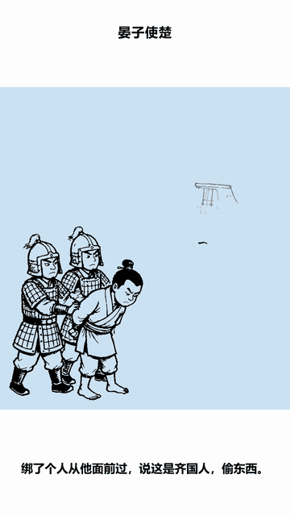
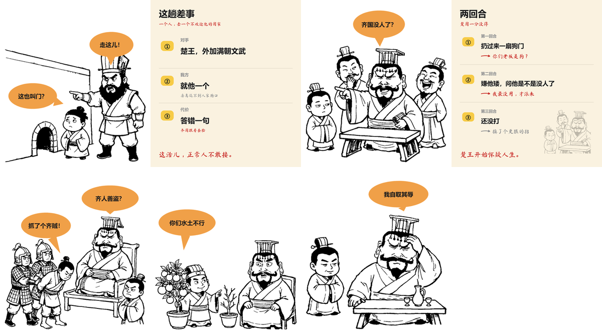
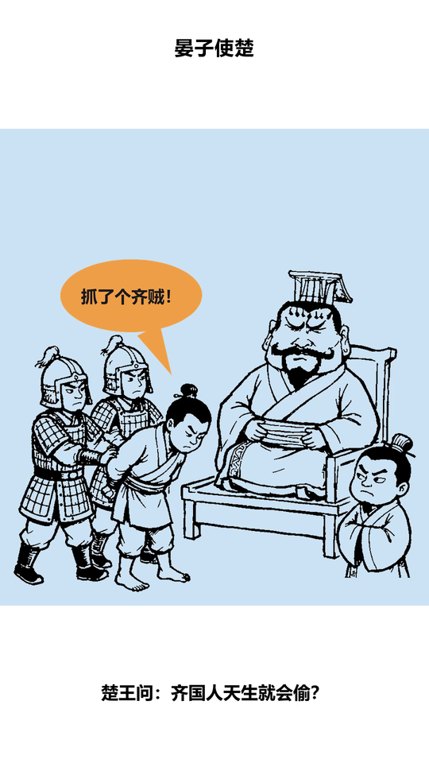
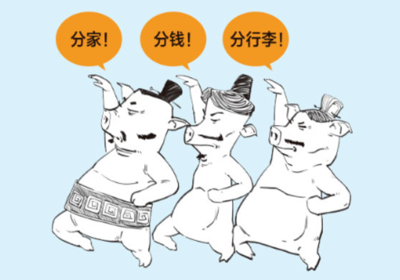
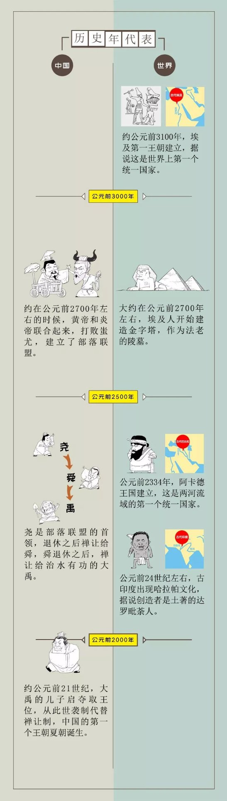

<div align="center">

# 漫画面讲故事 · comic-story-video

**把任何选题做成 110–135 秒竖屏漫画短视频：线稿被一笔笔描出来，台词气泡逐个弹入，配音加大字幕。**

图片在讲故事，不是给旁白配插图 —— 但故事先得讲在声音里，图才有得可配。

[](LICENSE)
[](https://www.python.org/)
[](https://pypi.org/project/whiteboard-animator/)

</div>

<p align="center">
  
</p>

<p align="center"><sub>↑ 成片里的 9 秒：白板引擎正在逐笔描线，气泡在旁白说到那一句时才弹出</sub></p>

---

## 它解决什么问题

绝大多数 AI 解说视频长这样：一张插画摆在中间，台词全挤在底部字幕条。
观众的眼睛其实一直在读字，图只是背景板。

这套方法把信息搬回画面里——**图是分镜，但声音是主线**：

| | 普通讲解片 | 本 skill |
|---|---|---|
| 图是什么 | 插图 / 背景板 | **分镜**：人物在指、在躲、在僵住 |
| 台词在哪 | 底部字幕条，声音不念 | **念白念出来，气泡再写一遍**，尾巴指向说话的人 |
| 判断标准 | 念白讲清楚了没 | **只听不看，能不能把故事复述出来** |
| 念白字数 | 越多越好（填满时间） | **信息优先**，上限按 4.0 字/秒反算 |
| 冲突怎么来 | 靠文案叙述 | 靠**人物关系**：指、躲、围、瘫 |

一句话：**声音讲事，画面加戏。图不是配图，但图也顶不了声音。**

---

## 效果

实测成片《晏子使楚》：**74 秒 / 1080×1920 / 7 格 / 349 字旁白**。

<p align="center">
  
</p>

B站效果： https://www.bilibili.com/video/BV1GT436HEwP/?vd_source=86926e418c83af75f6850b5546388a79


<p align="center"><sub>7 格里 5 个对话格 + 2 个信息图格，交替推进：狗门 → 底牌 → 开嘲 → 战况 → 绑贼 → 反击 → 收尾</sub></p>

<p align="center">
  
</p>

每一格都同时干三件事：**交代发生了什么**（人物动作）、**把原话念出来**（念白）、
**在画面上再写一遍最狠那句**（气泡 ≤8 字，重复是强调，不是错）。

整条片子的完整记录——可直接跑的 `story.json`、五张线稿的最终 prompt、两张信息图的代码、
四个坑的处置、抽帧验收数据——都在 [`references/demo-yianzi.md`](references/demo-yianzi.md)。

---

## 三个核心做法

**1. 生成模型只画线稿，一个字都不让它写。**
它写中文容易出乱码方块。台词、标签、强调圈、红圈全部由代码叠。
这句只写进 prompt 做预防 —— **出图后不要为了查有没有写字去逐张看图**，
零星符号在成片里看不见，为此重出是白花钱。

**2. 线稿进引擎逐笔描，气泡在合成时弹。**
白板引擎会把彩色区域二值化成黑块，所以气泡不能进引擎。
拆开反而更好：气泡的出场时机变得完全可控——旁白说到哪句，哪句才弹出来。

**3. 绘制节奏靠 `draw_duration`，不靠切图。**
引擎有两条调度路径，差别是决定性的：

- **传 `element_plan`** → 每个语义物体按「自然时长」画，上限 1.6 秒，画完就停。
  而引擎的分组会把整幅内容合并成很少几个物体，于是画面提前静止。
- **不传** → 按 √面积把 `draw_duration` 分给每个连通域，总时长恒等于它，天然铺满。

`element_plan` 是给「有逐句 TTS 时间戳」的场景准备的。没有真实时间戳时，
按字数估出来的窗口既不真实、又破坏了铺满 —— 所以**默认不传**。

```
同一格（10.5 秒）实测绘制进度
传 plan： 0.5s 0% → 1s 10.3% → 1.5s 10.6% → 10s 10.8%   ← 1.5 秒就画满，剩 9 秒不动
不传：    0.5s 0% → 1s 0.9%  → 2s 4.0%   → 4s 9.9% → 8s 10.8%  ← 铺满七成五
```

> 这条结论是量出来的，不是想出来的。早先版本往图里切三带、后来又在带边界
> 填白 2px「下刀」，都没用 —— 合并发生在引擎的分组阶段，切图管不到它。
> 现在 `comic_boards.py` 一步都不切。

---

## 快速开始

### 1) 安装

```bash
git clone https://github.com/liangdabiao/comic-story-video.git
cd comic-story-video

bash scripts/setup.sh                                            # macOS / Linux / Git Bash
powershell -ExecutionPolicy Bypass -File scripts/setup.ps1       # Windows
```

setup 会建 `.venv`、装依赖（含白板引擎与约 83MB 的 CRAFT 模型）、探测 ffmpeg 和字体。

### 2) 自检

```bash
python scripts/self_test.py          # 6 项检查，含一次 2 秒真渲染
```

### 3) 起一个项目

```bash
mkdir my-story && cd my-story
cp ../templates/comic/story.example.json story.json
cp ../templates/comic/charts_example.py charts.py
```

### 4) 过文案门禁，再出图

```bash
python ../scripts/pipeline.py . --stage script    # 字数、气泡坐标、charts 函数
python ../scripts/comic_gen.py . --list           # 打印还没出过的那几格的 prompt
```

`comic_gen.py` 会先跑一遍文案门禁：**没过就不打印 prompt**。
出图是整条链路最贵的一步（每张 5–10 credits），而文案没定稿的话图基本都会作废。

把 prompt 贴给任何图生图模型（ImageGen / 即梦 / Midjourney / SD），
**参考图必须传 `assets/reference/01-style-anchor.png`**，相似度调低。
生成的图按 `s1.png`、`s3.png` 命名放进 `raw/`。

出过的图再跑 `--list` 会标「已出图，跳过」，不会重复打印 —— 换了个 agent
重来时最费钱的就是把整批图又出一遍。

### 5) 一条命令出片

```bash
python ../scripts/pipeline.py . --stage image     # 图不可用就停在这
python ../scripts/comic_run.py .
python ../scripts/pipeline.py . --stage render    # 量绘制节奏
```

产物：`out/final.mp4`（1080×1920，含配音与烧录字幕）。

> 没有配音也能先看画面：`python ../scripts/comic_run.py . --skip tts`。

---

## 两道门禁 + 一道复核（`scripts/pipeline.py`）

写文档不够 —— 上一版把「先定稿文案再出图」「出图前检查连通域」都写进了散文，
实测一条片子还是文案改 3 版、图出 10 张用 6 张、返工两轮、墙钟 46 分钟。
所以判定改成了代码：

| 关 | 命令 | 拦什么 |
|---|---|---|
| ① 文案 | `--stage script` | 缺念白、总字数 >570、气泡出画、`charts.py` 里没有要的函数、`{角色}` 未定义 |
| ② 图 | `--stage image` | 缺图、几乎空白、整片涂黑（只有这三种） |
| ③ 节奏 | `--stage render` | **不拦人。** 只查 `plan.json` 有没有手写 `regions`，再打印每格动了几秒 |

前两关不通过就非零退出。**只拦会导致返工的结构性问题，风格建议一律只警告不阻断。**
第三关永远通过 —— 渲染节奏是参数问题，修在 `plan.json`，不在图。

判不准的指标一律只记录、不下判决 —— 这一条是踩过坑的：
`largest_share` 曾经被当成「>90% 必重出」，量了 6 个出片成功的项目之后推翻，
91~96% 的五格里有三格节奏完全正常（单人图的轮廓天然就是一块）。
按旧规则会白重出三张图。同理，「中灰 > 8% 就重出」也废除了：
通过的图里中灰有到 11.3% 的。

---

## 流水线

```
选题
 ├ ① 文案      写旁白 + 气泡台词              references/mixi-script.md
 ├ ② 出图      图生图，锚点图当参考            raw/s1.png
 ├ ③ 净化排版  二值化→抹水印→裁白边→统一画布   comic_boards.py
 ├ ④ 配音      MiniMax（apiz）或 edge 逐格出声 audio/s1.mp3
 ├ ⑤ 叠层      透明气泡 + 信息图               comic_layers.py
 ├ ⑥ 渲染      白板引擎逐笔描（最慢）          render_explainer.py
 └ ⑦ 合成      底色 + 线稿 + 气泡 → 字幕 → 竖屏 comic_finish.py
```

| 脚本 | 作用 |
|---|---|
| `scripts/pipeline.py` | **两道门禁**（文案 / 图，不过就非零退出）+ **一道复核**（节奏，不拦人） |
| `scripts/contact_sheet.py` | 把 8 格拼成一张总览图，看一次代替看八次 |
| `scripts/comic_gen.py` | 打印每格完整 prompt（出过的跳过；或调 Agnes 后端批量出图） |
| `scripts/comic_boards.py` | 净化、抹水印、统一画布、生成 `plan.json`（不切图） |
| `scripts/comic_tts.py` | 逐格配音，量真实时长，报字/秒；文案变了自动重配 |
| `scripts/comic_layers.py` | 透明气泡层 + 信息图整图 |
| `scripts/render_explainer.py` | 白板引擎渲染（`--only s3` 单格调试） |
| `scripts/comic_finish.py` | 合成、ASS 字幕、竖屏、响度归一 |
| `scripts/comic_run.py` | 一条命令全跑（`--skip` 跳过某几步） |
| `scripts/ink_probe.py` | 诊断用：查 `plan.json` 有没有 `regions`，打印每格怎么动的（**没有判定线**） |
| `scripts/verify_media.py` | 校验时长 / 分辨率 / 音轨 |

---

## story.json

唯一配置文件。一格一个对象：

```json
{
  "title": "晏子使楚",
  "voice": "zh-CN-YunjianNeural",
  "rate": "+14%",
  "scenes": [
    {
      "id": "s1",
      "type": "art",
      "src": "g1.png",
      "bg": "sky",
      "narration": "晏子要去楚国出差。楚国给他开的门，一米四。这不是门，这是狗洞。",
      "bubbles": [
        { "text": "这也叫门？", "tail": [392, 700] }
      ]
    },
    { "id": "s2", "type": "chart", "bg": "cream", "narration": "..." }
  ]
}
```

- `type: art` 线稿格，走白板引擎；`type: chart` 信息图格，走 `charts.py` 的静帧
- `bubbles[]` **只写 `text` 就能出片**：`at`（说到哪句才弹）和 `cx/cy/rx/ry`
  （位置大小）都会自动算，不用填
- 想让气泡指着某个人，加 `tail: [x, y]`（尾巴尖坐标），气泡自己跟过去；
  不写就居中放在画面上部，不用管
- 字号不用手调：字太宽会自动缩；缺字形会被预检拦下（防方框）

---

## 两类格子

一条片子只由这两种构成，交替出现，**对话格 : 信息图 ≈ 5 : 2**。

<p align="center">
  
  
</p>

**对话格**（浅蓝底 `#CBE3F5`）—— 解决「谁在说什么」

- 2–5 个角色，**彼此必须有关系**：指着对方、躲开、围住、瘫坐
- 橙色椭圆气泡，尾巴指向说话的人，**台词 ≤8 字**
- 红色手绘圈全格只压一处（一般是不说话那个人的眼睛）
- 底部不加东西 —— 位置留给大字幕

**信息图格**（米黄底 `#FAF2E0`）—— 解决「几回合、怎么收的」

- 标题 64 + 副题 30，3 行主体，每行一个大信息
- 黄色 `①②③` 标签 + 大字狠话 + 红字回击
- 一眼看完，不是「读」。字号下限 26，右侧留 60px
- **右下角自动铺一张淡掉的底衬**：三行字只占左边 2/3，右半边一定空。
  脚本按「上一格优先、兜底随机」挑图，按墨迹裁切后铺到 `opacity=0.28`，
  `charts.py` 一行都不用写。

推荐 8 格节奏（第 8 格是判词收尾，不能省）：

```
1 开场·立人物和赌注   2 信息图·把前提摆平   3 第一回合·第一次交手
4 第二回合·加码       5 信息图·把规律点破   6 第三回合·到顶
7 摊牌·一句话改写前面   8 判词·安静下来（bg=cream）
```

别套「主角反击、一句定胜负」—— 不是每条题材都有反杀，硬套会逼出假比分。

---

## 文案：贱萌，不是搞笑

决定观众留不留下来的是那句吐槽，不是画。

三条底层（详见 [`references/mixi-script.md`](references/mixi-script.md)）：

- **降格** —— 舌战群儒 →「一个人怼一屋子」
- **拆穿** —— 「你自比管仲乐毅，怎么越跟越惨？」→「**你吹的牛呢？**」
- **自曝** —— 主角必须有毛病，这本身就是把柄

最狠的一条硬规则：**台词必须念出来。**
念白里只写「他回了一句」「批了俩字」，等于没写 —— 听众没有画面可看，这就是断片。

> 早期文档在这里写「旁白里的台词和气泡里的台词绝不能是同一句」。**那条是错的，
> 已废。** 字幕本来就是重复声音，气泡再写一遍是最狠那句的二次强调。
> 真正要避免的是**重复且没有新信息**：念白只是把气泡换个说法，等于白配；
> 念白在推进（给根据、给后果、给吐槽），重复反而是好事。
> 气泡「齐国没人了？」，念白「翻译一下：就派你这么个矮子？」—— 这是递进。
> 念白只写「楚王问：齐国没人了吗？」—— 这是原地重复，要改。

---

## 出图纪律（成败就在这里）

**必须图生图。** 把 [`assets/reference/01-style-anchor.png`](assets/reference/01-style-anchor.png)
当参考图传进去。文生图每次都会漂：线条变粗、加阴影、加灰阶、脸型换一套。

**参考图相似度必须调低（low / 0.3–0.5）。** 这是最反直觉的一条：
相似度 `high` 时模型会**照抄参考图的姿势**，无视你写的动作。
实测同一句「伸食指水平指向右侧」，`high` 两次都出了「举手指天比 V」，`low` 一次就对。

**prompt 三段结构**，风格前缀逐字照抄（`scripts/comic_gen.py` 里的 `STYLE`）：

```
[风格前缀] + 内容：<谁>+<什么表情>+<什么动作，朝哪>+<在哪> + [尾部约束]
```

尾部两句一个字别省：

> 画面上方留出大片纯空白（留给对话气泡）。
> 绝对不要画任何文字、气泡、标题、对话框、边框、水印。

**体型差必须写成硬指标。** 想让角色显矮，别写「矮个子」——模型会给你一个正常身高的成年人，
梗当场就没了。要写「头顶只到旁边那人胸口」这种**可比较的参照**，末尾再加「体型差非常明显」。

**别预设返工率。** 以前这里写「多角色格两三成要重出」，那句话在给返工找理由 ——
看了就会放心挑毛病。现在只有两种情况真该重出：**该在的人不在**、
**整片涂黑或几乎空白**。其余一律记一笔往下走，成片整体过一遍再说。

---

## 常见故障

不报错但画面是错的那种，最难查。这些是实测踩出来的：

| 症状 | 真因 | 处置 |
|---|---|---|
| 分镜 2 秒就画满、后面不动 | `plan.json` 里手写了 `regions`，物体按 1.6s 上限画完即停 | 删掉 `regions` 重渲染（几十秒，零成本）。**不是重出图** |
| 背景是荧光绿 | `blend=all_mode=multiply` 在 YUV 空间算 | 改 `colorkey` + `overlay`（脚本已内置） |
| 信息图一直轻微晃动 | `zoompan` 缓推的取整抖动 | 已删 zoompan，改静止 + 0.35s 淡入 |
| 字幕飞出画面 | SRT + `force_style` 交给 libass | 手写 ASS，声明 `PlayResX/Y` |
| 长句字幕左右被裁 | libass 对中文不折行 | 已修：按标点折行（`_wrap()`） |
| 气泡里出方框 | 字体缺字形（`→`『』等） | `missing_glyphs()` 预检；符号改中文词 |
| 改了旁白，声音还是旧的 | 缓存只认「文件在不在」 | 已修：按文案+音色+语速取指纹 |
| 合并报「分拍合计 ≠ 成片时长」 | 分拍缓存是旧音频渲的 | 已修：比对时长，超 0.15s 自动重渲 |
| 模型照抄参考图姿势 | 相似度太高 | 调 low + 加「不要举手」负向词 |
| 所有人一样高 | 「矮个子」是无效描述 | 改「只到旁边那人胸口」+「体型差非常明显」 |
| 图右下角「AI生成」 | 生成模型水印 | `--watermark br` 抹掉（默认开） |
| 气泡压着脸 | 出图没留顶部空白 | prompt 加「上方留大片纯空白」 |
| 配音 403 | edge-tts 被 IP 级封锁 | 升到 ≥7.3；仍 403 换 apiz，见 `references/apiz-tts-fallback.md` |
| 语速调到 1.5 也没变快 | MiniMax `--speed` 1.3 以上饱和 | 节奏靠文本，别靠系数；`post_speed` 会丢气口 |
| 配音像播报、没起伏 | 用了公共音色，或音色描述缺「否定句」 | 用 `voice-design` 生成单口相声腔，见 `references/voice-design.md` |
| 自定义音色过几天消失 | 临时音色 168 小时未使用被回收 | 重跑 `voice-design`，描述留在项目里 |
| 一张图两三秒就画满、后面不动 | 深色衣物被涂成大片纯黑，人物连成一块 | 改浅色布衣 + 「不要大片涂黑」「人物之间留空隙」 |
| 渲染 `ArrayMemoryError` | 内存不足（1080 画布需 ≥3GB） | 关掉别的程序，或临时降宽 |
| 空镜像卡住 | 信息图是静帧 | `pad` 加 1–3 秒；要动就拆层逐行淡入，别加 zoompan |

---

## 验收：抽帧，别靠感觉

```bash
python scripts/verify_media.py --file out/final.mp4 --expect 74.3
ffmpeg -y -ss 3 -i out/final.mp4 -vframes 1 check/03.png
ffmpeg -i out/final.mp4 -af volumedetect -f null -     # mean_volume 应在 -20 ~ -14 dB
```

四件事只有肉眼能发现：

1. **绘制是否铺开** —— 抽第 3 秒和该格 75% 处两帧，画面不一样就够，不用跑工具
2. **气泡是否逐个弹出** —— 3 秒前不该有气泡
3. **底色是否正确** —— 浅蓝 / 米黄，不是绿、不是白
4. **字幕是否出画** —— 字号、位置、有没有被裁

**及格线**：**只听不看，能把整个故事复述出来**（谁、要什么、几件事、说了什么、怎么收）；
每格至少有一句能听见的台词或动作落点；念白里有一句让人想复述的吐槽；
最后一格给了一句新判词。

**不及格**：念白里全是「他说了一句」这种占位符、图是并排站着的肖像、
念白在念名词定义、讲完最后一个事实就切黑。

---

## 项目结构

```
comic-story-video/
├── SKILL.md                   skill 主文档（agent 读这个）
├── README.md
├── scripts/
│   ├── pipeline.py            两道门禁：文案 / 图（节奏只复核，不拦人）
│   ├── contact_sheet.py       分镜拼成一张总览图（省看图 token）
│   ├── comic_gen.py           出图 prompt（出过的跳过）/ 批量出图
│   ├── comic_boards.py        净化 + 落版（不切图）
│   ├── comic_tts.py           逐格配音
│   ├── comic_layers.py        气泡层 + 信息图
│   ├── comic_finish.py        合成 + 字幕 + 竖屏
│   ├── comic_run.py           一条命令全跑
│   ├── render_explainer.py    白板引擎渲染器
│   ├── ink_probe.py           诊断：查 plan.json 的 regions + 打印每格怎么动的
│   ├── self_test.py           环境自检
│   ├── verify_media.py        产物校验
│   └── setup.sh / setup.ps1
├── lib/
│   ├── comic_layer.py         叙事层：气泡 / 标签 / 红圈 / 手写注 / 箭头
│   ├── story_util.py          story.json 读数：字数、prompt 指纹、角色展开、气泡时刻
│   ├── lineart_clean.py       线稿净化 + 连通域体检
│   ├── theme.py               ffmpeg 定位
│   └── lib_agnes.py           可选：Agnes 图生图后端
├── assets/
│   ├── fonts/                 手写体（马善政楷书，OFL）
│   ├── reference/             风格锚点 + 两类格子范例
│   └── demo/                  README 用的演示截图与 GIF
├── templates/comic/           story.json 与 charts.py 模板
├── references/
│   ├── demo-yianzi.md         完整案例：晏子使楚 74 秒全流程
│   ├── comic-story.md         完整制作手册（唯一真相）
│   ├── mixi-script.md         文案方法：降格 / 拆穿 / 自曝
│   ├── prompt-recipes.md      出图 prompt 库
│   ├── voice-design.md        配音首选：单口相声音色的生成方法与描述原文
│   └── apiz-tts-fallback.md   apiz 接入细节与 edge 403 排查
└── vendor/ATTRIBUTION.md      第三方组件归属
```

---

## 依赖

| 依赖 | 必须？ | 说明 |
|---|---|---|
| Python 3.10+ | 必须 | |
| `whiteboard-animator==0.1.1` | 必须 | 白板引擎（PyPI），自带 83MB CRAFT 模型 |
| `ffmpeg`（含 libx264） | 必须 | 合成、竖屏、字幕 |
| `edge-tts>=7.3` | 可选 | 免费配音；7.2.x 会被 Edge 拒绝（403）。**想要混子哥那口气要用 apiz / MiniMax**，见 `references/apiz-tts-fallback.md` |
| `apiz` CLI | 可选 | MiniMax 语音。**首选**：`voice-design` 生成单口相声音色，`speed 1.0` |
| `fonttools` | 建议 | 字形预检（防气泡里出方框） |
| 图生图模型 | 必须 | ImageGen / 即梦 / Midjourney / SD 均可 |
| `AGNES_API_KEY` | 可选 | 想让脚本自己批量出图时才需要 |

`ffprobe` 可选，缺了会自动退回 `ffmpeg` 解析时长。
引擎与 CRAFT 模型不随本仓库分发，由 setup 从 PyPI 拉取，归属见 [`vendor/ATTRIBUTION.md`](vendor/ATTRIBUTION.md)。

---

## 已知限制

- **prompt 对「谁指谁」控制力有限**：多角色格偶尔画错动作。但这不构成重出理由 ——
  只有「该在的人不在」和「整片涂黑」才重出，其余观众看不出来。
- **角色不做统一**：每格可以是不同的人，靠风格锚点保持画风一致。
  要固定同一张脸，得把上一格当参考链式传下去。
- **信息图要写代码**：每期内容不同，不适合做成配置。`Comic` 已给齐积木，一张图通常 20 行。
- **1080 画布需 ≥3GB 可用内存**，否则渲染会 `ArrayMemoryError`。
- **节奏偏慢**：74 秒 7 格，一格 9~13 秒。想更快就把信息图格压到 8 秒。

---

## 装进 agent

```bash
# 作为 skill 装到 agent（推荐放项目级：<项目>/.workbuddy/skills/comic-story-video）
git clone https://github.com/liangdabiao/comic-story-video.git \
  .workbuddy/skills/comic-story-video
bash .workbuddy/skills/comic-story-video/scripts/setup.sh
```

装好后按关键词自动激活（「漫画讲故事」「混子哥风格」「图片讲故事」「漫画分镜视频」），
也可手动作业：

> 用 comic-story-video 做一期：晏子使楚

agent 会读 `SKILL.md`，按流水线走完文案 → 出图 → 排版 → 配音 → 渲染 → 合成。

---

## 致谢与 License

- 绘制引擎：[whiteboard-animator](https://github.com/masihsultani/whiteboard-animator)（MIT），文字检测用 [CRAFT-pytorch](https://github.com/clovaai/CRAFT-pytorch)
- 手写字体：马善政楷书（SIL Open Font License，见 `assets/fonts/OFL-MaShanZheng.txt`）
- 叙事与文案方法参考「混子哥」的漫画解说风格，仅供学习研究

https://linux.do 社区支持感谢

本项目：[MIT](LICENSE) © comic-story-video contributors

