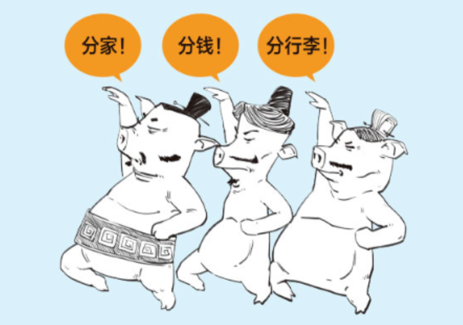
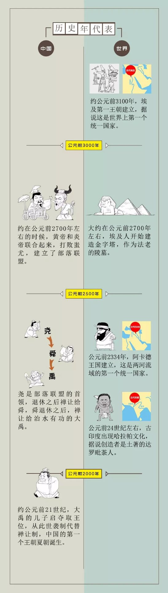
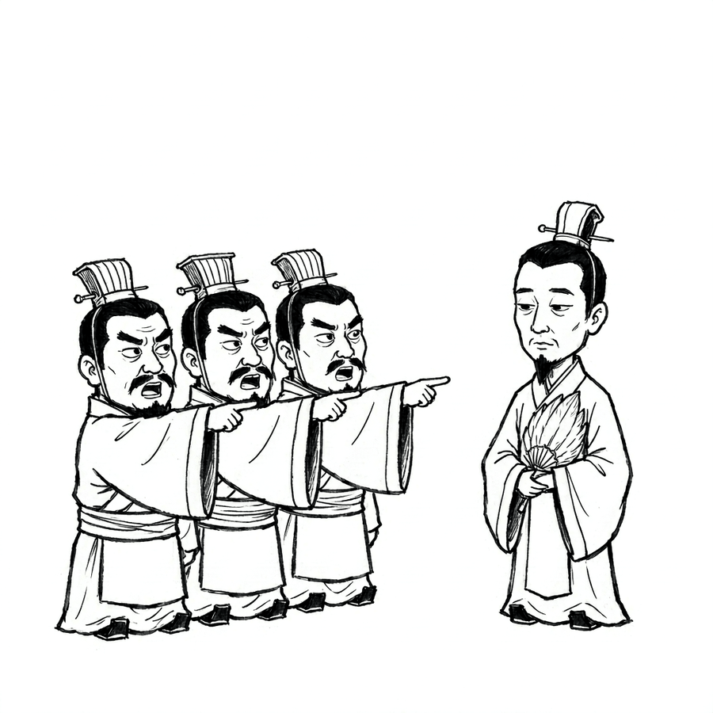

# 图片讲故事：完整制作手册

> 这份文档是整条流水线的唯一真相。看完它，你应该能从零做出 110–135 秒的
> 「图片在讲故事」竖屏短视频：8 格、有配音、有大字幕、气泡逐个弹出。

---

## 0. 一句话说清这套方法和普通讲解片的区别

**普通讲解片：一张插图 + 底部字幕。图是配图，信息全在声音里。**
**这套方法：图是分镜，人物在指、在躲、在僵住 —— 但话必须念出来。**
台词只写在画面上、声音不念，等于让观众去看字幕；画面再热闹，盲听也是断的。

观众的眼睛只做一件事——看画面。声音是补充，不是主线。

所以判断标准很粗暴：**把声音关掉，你还能看懂这格在吵什么吗？**
不能，就说明台词没进画面，回去改。

---

## 1. 画面语言：只有两种格子

整条片子由两类格子交替组成。只用一种，节奏就是平的。

### 1.1 对话格 —— 解决「谁在说什么」



配方（从上到下）：

| 层 | 元素 | 要求 |
|---|---|---|
| 1 | 2–5 个角色 | **彼此必须有关系**：指着对方、躲开、瘫坐、围住。不是并排站肖像 |
| 2 | 台词气泡 | 橙色椭圆，尾巴指向说话的人。一句一个，**绝不超过 8 字** |
| 3 | 强调圈 | 红色手绘圈，**全格只压一处**（一般是不说话的那个人的眼睛） |
| 4 | 底色 | 浅蓝 `#CBE3F5`，底部不加字 —— 那个位置留给大字幕 |

三条最容易违反的：

- **角色之间必须有动作关系。** 「三个人站成一排」是肖像，「三个人伸手同指右侧」才是分镜。
- **气泡不超过 8 字。** 超过就不是台词，是旁白。旁白该进声音，不该进画面。
  （反过来不成立：台词**必须**念出来。气泡短是因为画面装不下，不是因为台词归画面。）
- **红圈只有一个。** 圈两处等于没圈。

### 1.2 信息图格 —— 解决「几回合、怎么收的」



配方：

| 层 | 元素 | 要求 |
|---|---|---|
| 1 | 标题 + 副题 | 标题 64 号黑体，副题 30–34 号，副题用红或灰 |
| 2 | 3 行主体 | 每行一个大信息，**层级最多两级** |
| 3 | 序号标签 | 黄色圆角块 + ①②③，编号让人知道这是第几回合 |
| 4 | 箭头 + 回击 | 红箭头 + 红字，一行一句话 |
| 5 | 分隔线 | 极浅的 2px 横线，不要实框 |
| 6 | 底色 | 米黄 `#FAF2E0` |

硬要求：

- **一眼看完，不是「读」。** 一行只放一个信息。三行就是上限。
- **字号下限 26。** 手机上看 24 号以下等于没有。
- **右侧留 60px 以上。** 竖屏合成时四周要留白，贴边的字会被裁。

**版面右半边一定会空**——三行文字实际只占左边 2/3，右下角是一大片米黄。
所以**每张信息图都自动铺一张淡掉的底衬**，不需要你写代码：

```
python scripts/comic_layers.py <项目> --only charts
     底衬 ← boards/s1.png      ← 打印出来告诉你用了哪张
  charts/s2.png
```

`comic_layers.build_charts()` 在调 `fn(c)` **之前**做四件事，charts.py 完全无感：

| 步骤 | 规则 |
|---|---|
| 选图 | 本格之前**最近的一个线稿格**（「上一回合」语义最准）；前面没有就按格的 id 固定随机一张 |
| 裁切 | 按墨迹包围盒裁掉「上方给气泡留的白」，四周再放 20px |
| 缩放 | `fit="contain"` 装进右下角 `655,715,365,425`，右/下各留 60px |
| 淡化 | `opacity=0.28` |

四条必须知道的原因：

- **顺序是「先贴图、再画字」**。`art()` 走 `multiply`，反了字会被压暗一遍。
  所以这件事只能在 `fn(c)` 之前做，charts.py 里**不要**再自己 `art()`，会叠两层。
- **必须按墨迹裁**。整格 1080×1200 塞进 365×425 的框，人物只剩两三百像素，糊成线团。
- **`opacity` 0.28 是实测值**。0.22 只剩一团灰影，0.45 以上开始跟标题抢视线。
- **右、下各留 60px**。贴边会被读成「图溢出画布」。

某格不想要（比如版面本来就满），`story.json` 里写 `"backdrop": false`。
想让画面更有节奏，就别靠底衬，改**拆层逐行淡入**（第一回合 → 第二回合 → 第三回合
依次出现），代价是 `charts.py` 要能按步骤输出多张 png。

不要用 zoompan 缓推来「让它动」，那是抖的（见铁律 2）。

### 1.3 配比与节奏

110–125 秒、8 格的推荐结构：

```
格1  对话格 · 冲突先行     —— 垫话开场，直接开打，不铺垫
格2  信息图 · 底牌         —— 谁强谁弱，一张表说清
格3  对话格 · 对手开炮     —— 第一回合
格4  对话格 · 对手加码     —— 第二回合
格5  信息图 · 战况汇总     —— 打完架回头数战果
格6  对话格 · 主角反击     —— 一句定胜负
格7  对话格 · 反转         —— 把「事」讲完：最后那个转折
格8  对话格 · 判词收尾     —— 把「意思」讲透：bg 换 cream，安静下来
```

**格 7 和格 8 是两件事，不能合并。** 早期只有 7 格、格 7 兼做反转和收尾，
结果就是「说完最后一个事实立刻切黑」——观众的第一反应是「啊？没了？」。
格 7 只负责事实（写诗 → 被贬海南），格 8 才负责意义（他不是豁达，他是真觉得值）。

**对话格 : 信息图 ≈ 5 : 2**。信息图多了像课件，少了没结构。
格 5 用信息图是故意的：那一格要讲的是「前两回的共同点」，一张图就摆平，不必拿对话铺。
**但信息图省的是画面，不是念白** —— 图上写「两回合、零比二」，念白要给的是
「这两回佛印都是后出手」这一层判断。图给结构，声音给结论，两边都不能空。

**格 8 的三个具体做法**（照抄）：

| 项 | 怎么设 |
|---|---|
| `bg` | `cream`（前七格是 `sky`）。视觉上就是「落定」 |
| 气泡 | 最多一个，两个字最好（「值了」）。它是句号，不是又一段对话 |
| `at` | 不用填，按念白自动反推（这段台词在哪句，气泡就在那时弹） |
| 时长 | 会比平均格长 50%（21.5s vs 15s），语速要慢，别去砍 |

格 8 的旁白结构见 SKILL.md「收尾：必须有总结格」一节：**先否掉一个流行说法，
再用具体物件顶上去，最后落一句能单独摘出来的判词。**

---

## 2. 五段流水线

```
选题
 │
 ├─① 文案        写 narrration + 气泡台词        references/mixi-script.md
 │
 ├─② 分镜        定每格画什么 + 出图 prompt      story.json
 │
 ├─③ 出图        图生图，风格锚点当参考          assets/reference/01-style-anchor.png
 │                → raw/s1.png …
 │
 ├─④ 净化排版    线稿净化 + 统一画布（不切图）    scripts/comic_boards.py
 │                → boards/s1.png + plan.json
 │
 ├─⑤ 配音        edge-tts 逐格出声               scripts/comic_tts.py
 │                → audio/s1.mp3（时长定节奏）
 │
 ├─⑥ 叠层        气泡透明层 + 信息图             scripts/comic_layers.py
 │                → bubbles/ + charts/
 │
 ├─⑦ 逐笔渲染    白板引擎把线稿一笔笔描出来      scripts/render_explainer.py
 │                → out/lineart_parts/s1.mp4
 │
 └─⑧ 合成        底色 + 线稿 + 气泡 → 字幕 → 竖屏 scripts/comic_finish.py
                  → out/final.mp4
```

一条命令跑完：

```bash
python scripts/comic_run.py <项目目录>
```

单步重跑用对应的 `comic_*.py`。

### 项目目录长这样

```
<项目目录>/
├── story.json          唯一配置：标题、画布、每格文案/气泡/prompt
├── charts.py           信息图格的绘图函数（可选，有 chart 格才需要）
├── raw/                生成模型出的原图（你放进来）
├── boards/             净化 + 排好版的线稿（脚本产出）
├── bubbles/            透明气泡层（脚本产出）
├── charts/             信息图整图（脚本产出）
├── audio/              逐格配音（脚本产出）
├── out/
│   ├── lineart_parts/  引擎逐格渲染产物
│   ├── segs/           合成后的分段
│   ├── story_flat.mp4  平屏成片
│   └── final.mp4       最终竖屏成片
└── subs.ass            字幕
```

---

## 3. 出图纪律（这一步决定成败）

### 3.1 必须图生图，不能文生图

文生图每次都会漂：线条变粗、加阴影、加灰阶、脸型换一套。
把**同一张风格锚点图**当参考，画风才稳定 —— 而角色可以整批换掉。

[`assets/reference/01-style-anchor.png`](../assets/reference/01-style-anchor.png)
就是锚点。每次出图都把它作为 image reference 传进去。



上面这张就是「锚点图 + 一句话换场景」的结果：同样的粗黑眉、眯缝凶眼、
方阔脸、交领束带，但角色全换了。**一次调用产出一个新分镜。**

### 3.2 prompt 的三段结构

```
[风格前缀]  +  内容：<谁、什么表情、什么动作、在哪、朝哪>  +  [尾部约束]
```

风格前缀**逐字照抄**（在 `scripts/comic_gen.py` 的 `STYLE` 里）：

> 白底黑白线稿的简笔漫画，手绘马克笔风格。纯白背景，只有黑色线条和少量纯黑填色
> （眉毛、胡须、眼珠、头发、冠帽），绝对不要灰度、不要阴影、不要排线、
> 不要纸张纹理、不要彩色。线条干净肯定、带轻微不规则的手感。漫画夸张比例，头大身小。

尾部约束两句，一个字都别省：

> 画面上方留出大片纯空白（留给对话气泡）。
> 绝对不要画任何文字、气泡、标题、对话框、边框、水印。

**为什么写这句**：生成模型写中文容易出乱码方块，所以要预防。台词一律由代码叠。

但**这句是写 prompt 用的，不是出图验收标准**。生成模型经常会画点别的东西：
纸牌上印个日文、机身上印个 `+` `−`、角落添个猫图案。这些**不用重出** ——
竖屏手机上十秒一格，看不见，而且气泡和字幕常常正好盖在上面。
上一版把「图上有没有文字」列成出图后必查的一条，实测就为了这个白重出过一张图。

`python scripts/comic_gen.py <项目目录> --list` 会把每格拼好的 prompt 打出来，
直接贴给任何图生图工具。

### 3.3 参考图相似度：必须调到 low

这是最反直觉的一条。

| 相似度 | 结果 |
|---|---|
| high | **模型照抄参考图的姿势**，无视你写的动作。要「伸手指向右侧」，给你「举手指天比 V」 |
| low | 画风照样继承（因为前缀够详细），但动作听 prompt 的 |

实测：同一句「伸出一根食指水平指向右侧」，`high` 出了两次都是竖起来的 V 手势，
`low` 一次就对。**参考图相似度太高，会吃掉 prompt 的肢体控制。**

### 3.4 构图要留出「上面那片白」

人物必须沉在画面下半部，上方留 200–300px 纯白。
不留，气泡就只能压在脸上；留了，气泡尾巴 40px 就能接到头顶。

脚本里 `FLOOR_RATIO = 0.983` 会把人物脚底对齐到画布 98.3% 处，
上半部自然是空的 —— 但前提是原图上方本来就有白。

### 3.5 出完图：只看叙事，不看细节

图生图会静默出错。文件是好的、尺寸是对的、没有报错，但画里是错的。
所以要看 —— 但**拼一张总览图看一次**，只看两种会让观众看不懂故事的错：

```bash
python scripts/contact_sheet.py <项目>     # → _contact.png
```

八张单看每张都「还行」，并排才好比较。一次看图的成本和看八次差八倍。

| # | 看什么 | 典型错法 | 处置 |
|---|---|---|---|
| 1 | **人数** | 少画一个该在场的人；或者凭空多出一个「路人」挤在两人中间 | 重出这一格 |
| 2 | **整片涂黑 / 基本空白** | 围裙官袍涂成一坨纯黑；或者整张几乎没画东西 | 重出（`pipeline.py` 也会算出来） |

**下面这些以前被列成「必须重出」，现在全部降级为「不看」**：

| 以前写「不过就重出」 | 现在的判断 |
|---|---|
| 有没有文字（角落补标题、纸上写假字） | **不看**。竖屏手机上十秒一格，看不见；气泡和字幕还会盖上去 |
| 顶部是否大片纯白 | **不看**。留白少就把气泡往上挪或缩小 `ry`，这不需要重出图 |
| 有没有灰阶 | **不看**。二值化会处理掉，实测通过的图里中灰到 11.3% 都正常出片 |
| 人物是否完整（头被切、脚出画） | **看一眼就够**。脚出画是常态，`FLOOR_RATIO` 会把脚底对齐到 98.3%，本来就该贴着底边 |
| 两个角色能否一眼分清 | **写 prompt 时就要保证**（§2.0 角色身份证），不是出图后验 —— 写好了自然分得清 |
| 格与格之间身高飘 | **不看**。除非笑点就是身高 |

> **这条改动的来历**：上一版写了「六条任一条不过就重出」，实测一条片子里
> 5 张有 4 张完美，唯一那张只是纸牌上印了日文、机身上有 `+` `−` 符号，
> 被判「违反 NO_TEXT，必须重出」。重出要花 5–10 credits + 一次看图，
> 而那个瑕疵在成片里根本看不见。**规则写得太严，浪费的是真的钱和时间。**

一张图**看一次**就够了。不要为了确认「尾巴是不是落在头顶正中央」把同一张图
看好几遍 —— 每次看图 1.5–2.5k token，反复看比出图还贵。

### 3.6 返工率：不是「两三成必须重出」

单角色格基本一次过。多角色格（3 人以上、要指定谁指谁）偶尔会把动作画错 ——
但**不改构图也能出片**，只是那格画面没那么有戏。

**「画得不够好看」不是重出理由。** 唯一值得回头的是叙事错误：
人数错、主角被认成配角。这两类出现频率远低于「两三成」，
上一版把返工率写成两三成，直接导致每格都被挑一遍。

要改的话：
- 一格一图，别把 7 格塞进一张。
- 真要重出，**加负向约束**比改正向描述有效：「不要画举起手臂的动作，不要画手指比 V」。
- 与其重出图，不如**调气泡和字幕** —— 那是免费的，而且观众看的是字。

---

## 4. 绘制节奏：引擎的两条调度路径

这是全套方法里唯一必须理解引擎内部的地方。

### 4.1 现象：画面 1.5 秒就画满了

10.5 秒的分镜，逐帧量墨迹覆盖率：

```
0.5s  5.86%     1.5s 10.64%     4s 10.82%     10s 10.83%
1.0s 10.28%     2.0s 10.72%     6s 10.83%
```

1.5 秒就到 98%，之后 8.5 秒纹丝不动。另一条片子（s3，11.7 秒）稍好，
也是 4 秒画满 15.32%、剩 7 秒静止。

> 早先文档里写的是「1 秒只出轮廓、8 秒画完、正好铺满 13 秒旁白」——
> 那句话是编的，没人量过。它错了很久，后面所有关于「三带切分」的叙述
> 都建在它上面。教训：**凡是写「实测」，就必须真有一张曲线图。**

### 4.2 真因：`element_plan` 把时间锁死在 1.6 秒

引擎有两条调度路径，由 `has_boxes` 决定：

| 路径 | 触发 | 行为 |
|---|---|---|
| `_schedule_semantic_objects` | 传了 `element_plan` | 每个语义物体算「自然时长」`0.28 + √面积/190 + 子笔画×0.07`，**上限 1.6 秒**；窗口富余时也不拉伸，画完就停 |
| `_schedule_components` | 不传 | 按 √面积把 `draw_duration` 分给每个连通域，**总时长恒等于 `draw_duration`** |

而第一路的「语义物体」是引擎把整幅内容分组的结果 —— 一张多角色图里
八成墨迹连成一整块，就被当成**一个**物体，1.6 秒描完。

实测证据（打桩打印调度）：6 个 region 的格子，**起点 0.0s 的那个物体占了 98% 墨迹**，
所有区域在 1.46 秒内一次画完。三条带、六条带都一样，因为切的是 box，
不是引擎的分组。

### 4.3 正确做法：不传 `element_plan`

`element_plan` 本来是为「有逐句 TTS 真实时间戳」准备的 —— 讲到哪句画哪块。
我们没有逐句时间戳，`build_windows` 只能按字符数瞎估，估出来的窗口既不真实，
又激活了 1.6 秒上限。

所以 `render_explainer.py` 现在只在 region 真的写了 `start`/`end` 时才用 plan，
否则走 `_schedule_components`：

```python
animator.render_to_file(img, total * DRAW_BUDGET, total, out,
                        fps=fps, bitrate=bitrate, element_plan=None)
```

`draw_duration = total × 0.75`（`DRAW_BUDGET`）。

同一格重测：

```
0.5s 0.00%   1s 0.86%   2s 4.04%   3s 6.91%   4s 9.95%
5s 10.46%    6s 10.63%  7s 10.76%  8s 10.83%  9–10s 静止
```

0→4 秒均匀推进，8 秒画满，剩 2.5 秒留给气泡和收尾。
五格实测 95% 时间点落在预算的 70%~104%，全部命中。

### 4.4 三条试过但无效的路

记下来，免得以后又走一遍：

| 做法 | 为什么无效 |
|---|---|
| 切成三条横带当 region | box 只决定「先后窗口」，不改变引擎的分组。实测 1 秒时三条带已分别完成 83% / 96% / 98% |
| 在带边界填白 2px「下刀」 | 连通域确实从 27 涨到 53，但引擎仍把整幅并成一个语义物体，曲线一点没变 |
| 加带数（6~8 条） | 同上。物体数由引擎分组决定，不由 region 数决定 |

根因是**分组发生在引擎内部，脚本在图像层面怎么切都影响不到它**。
唯一有效的旋钮是「传不传 plan」。

顺带：`comic_boards.py` 现在完全不切图，只做净化 + 落版 + 写 plan。

### 4.5 一条诊断命令

```bash
python scripts/ink_probe.py <项目目录>
```

抽帧量每格的墨迹曲线，打印「95% 出现在第几秒 / 预算第几秒 / 百分比」，
偏离 55%~115% 就报警并返回非零退出码。输出长这样：

```
s1  10.5s  墨迹 12.66%  95% 在 5.5s（预算 7.9s，70%）  ✓ 节奏正常
```

**⚠ 不等于必须返工。** 先按这个顺序查，别跳步：

1. **有没有传 `element_plan`？** 传了必然 1~2 秒画完（§4.2）。九成的「画太快」
   到这一步就解释完了，跟图没有关系。
2. 没传还快，再看 `boards_meta.json` 里的 `largest_share`。

| t95 | largest_share | 真因 | 处置 |
|---|---|---|---|
| < 40% | 任意 | **先怀疑 `element_plan`** | 去掉 `regions` 重渲，再看 |
| < 40% | > 80% | 整幅连成一块，前几秒一口气铺满 | 改浅色衣物 + 人物留空隙（§3.5） |
| 45%–55% | > 80% | 同上，只是程度轻 | **可以不返工。** 重出要冒丢掉已画对的身份特征的风险 |
| 45%–55% | < 60% | 预算偏紧 | 降一点 `DRAW_BUDGET` 或加长该格 |
| > 115% | 任意 | 画不完就切了 | `DRAW_BUDGET` 砍到 0.7 |

> **`largest_share` 单独看没有意义，别拿它当门禁。** 实测 6 个出片成功的项目，
> 91~96% 的五格里有三格节奏正常（惠州 s7 95.0% → 57%，惠州 s4 91.1% → 57%，
> 佛印 s8 92.4% → 67%）。单人图的人物轮廓天然就是一块。
> 它只在「t95 已经偏低」时用来区分原因，不单独判决。

想看整批图的体检：

```bash
python scripts/pipeline.py <项目> --stage image     # 一条命令，含判定
python lib/lineart_clean.py raw/s1.png --stats      # 只看单张的数
```

---

## 5. 合成与字幕：三条铁律

这三条都是实测踩出来的，违反任何一条都会静默出错——不报错，但画面是错的。

### 铁律 1：底色不能用 `blend=all_mode=multiply`

```
blend=all_mode=multiply   → 背景变成荧光绿 (89,255,84)
colorkey + overlay        → 背景精确还原 (202,226,244)  ✓
```

即使写了 `format=rgb24`，multiply 内部仍按 YUV 算，浅蓝的色度分量被一起乘掉。
改用 `colorkey=0xFFFFFF:0.12:0.04` 把白底抠透明，再 overlay 到底色上。

### 铁律 2：信息图不要加 `zoompan` 缓推

早期为了「别让静帧像卡住」，给信息图挂了一条慢速推近：

```bash
# ✗ 已经删掉，不要再用
-vf "zoompan=z='1+0.0004*on':x='(iw-iw/zoom)/2':y='(ih-ih/zoom)/2':d=1:s=1080x1200:fps=30"
```

症状是**画面一直在极轻微地晃 / 呼吸**，字边缘毛刺，看久了晕。

成因：输入 = 输出分辨率时，裁剪窗宽 `1080/zoom` 是小数（1079.6、1079.2…），
ffmpeg 每帧取整，等于**每两三帧横竖各跳 1px**；再叠上 `yuv420p` 每帧色度抽样错位，
细笔画就被反复重采样。

正确做法：**静止 + 淡入**。

```bash
# ✓
-vf "fade=t=in:st=0:d=0.35,format=yuv420p"
```

信息图是给人读的，读的时候画面不该动。想让信息图「有节奏」，正解是
**拆层逐行淡入**（第一回合出现 → 第二回合 → 第三回合），让信息一行一行落位，
而不是给一整张静态图加无意义的缓推。

### 铁律 3：字幕必须烧 ASS 本体

```bash
# ✗ 错：libass 落到 384×288 默认坐标系，58 号字变成几百像素，飞出画面
subtitles=subs.srt:force_style='FontSize=58'

# ✓ 对：自己写 ASS，明确声明 PlayResX / PlayResY
subtitles=subs.ass
```

ASS 头必须写：

```
[Script Info]
PlayResX: 1080
PlayResY: 1920
```

字幕时序按**分镜时长 + 字数比例**分配，尾部留 4% 静音，别顶到最后一个字。

### 竖屏合成参数

```
平屏 1080×1200  →  pad 到 1080×1920，顶部偏移 324
                  →  烧 subs.ass
                  →  loudnorm=I=-16:TP=-1.5:LRA=11
```

顶部偏移留白给标题，底部留白给字幕。别把画面顶到最上面，抖音会挡。

---

## 6. 验收：抽帧，别靠感觉

渲染完一定抽帧看。三类问题只有肉眼能发现。

```bash
# 抽 8 个时间点拼成一张检查图
ffmpeg -y -ss 3 -i out/final.mp4 -vframes 1 check/03.png
```

要看的四件事：

1. **绘制是否铺开**：跑 `scripts/ink_probe.py`，每格 95% 时间点应落在预算的 55%~115%。
2. **气泡是否逐个弹出**：`at` 是自动反推的，3 秒前不应该有气泡；出现了才需要手填。
3. **底色是否正确**：应该是浅蓝/米黄，不是绿、不是白。
4. **字幕是否出画**：字号、位置、有没有被裁。

音频单独查：

```bash
ffmpeg -i out/final.mp4 -af volumedetect -f null -
# mean_volume 应在 -20 ~ -14 dB
```

---

## 7. 踩坑实录

| 症状 | 真因 | 处置 |
|---|---|---|
| 分镜 2 秒就画完，后面不动 | 传了 `element_plan`，物体按 1.6s 上限画完即停 | 去掉 `regions` 走均分铺满（见 §4.3） |
| 改了旁白，重跑声音却没变 | 缓存只判断「文件在不在」 | 已修：`comic_tts.py` 用文案+音色+语速取指纹，变了就重配 |
| 换了图但成片画面没变 | 分拍缓存只比时长 | 已修：`render_explainer.py` 写 `.stamp` 指纹（图内容+音频+画质） |
| 主角和配角长得像同一个人 | 主角戴了配角同款、只是矮一点的冠 | 主角换异类头饰 + 去胡须，见 `prompt-recipes.md` §2.0 |
| 合并报「分拍合计 ≠ 成片时长」 | 分拍 mp4 是按旧音频渲的 | 已修：`render_explainer.py` 比对缓存时长，差 >0.15s 自动重渲 |
| 背景是荧光绿 | multiply 在 YUV 空间算 | 改 colorkey + overlay |
| 信息图一直在轻微晃动、字边毛刺 | zoompan 缓推的裁剪窗是小数，每两三帧跳 1px | 已删 zoompan，改静止 + 0.35s 淡入 |
| 字幕飞出画面 | SRT 交给 libass | 手写 ASS，声明 PlayResX/Y |
| 气泡里出方框 | 字体缺字形（`→`『』等） | `missing_glyphs()` 预检；符号改中文词 |
| 气泡尾巴像根长针 | 气泡离人太远 | 气泡压低，尾巴 ≤60px；`tail_w` ≥50 |
| 人物上方没留白，气泡压脸 | 出图 prompt 没要求上方留白 | 加「画面上方留大片纯空白」 |
| 模型照抄参考图的姿势 | `input_fidelity=high` | 调到 low |
| 模型把所有人画成同一身高 | 「矮个子」不是可执行描述 | 写成「头顶只到旁边那人胸口」+「体型差非常明显」 |
| 图右下角有「AI生成」 | 生成模型水印 | `--watermark br` 自动抹掉 |
| 人物太小，尾巴要拖很长 | 原图四周空白太多 | 脚本已自动裁白边 + 放大到 1040 宽 |
| 空镜看着像卡住 | 信息图是静帧 | `pad` 加 1~3 秒；**不要**加 zoompan，改成拆层逐行淡入 |
| 配音 403 | edge-tts 被 IP 级封锁 | 升级到 ≥7.3；仍 403 换 apiz，见 `apiz-tts-fallback.md` |
| 大尺寸渲染 `ArrayMemoryError` | 内存不足（1080 画布需 ≥3GB 可用） | 关掉别的程序，或临时降到 900 宽 |
| 时长对不上 | concat 混入坏分片 | 删 `out/segs` 重跑 |

---

## 8. 换选题：9 步，顺序不能换

**顺序本身就是省钱。** 出图是最贵的一步，文案是最容易变的一步 ——
把最容易变的那步放在最贵的后面，改一次就废一批图。

| # | 做什么 | 命令 / 产物 |
|---|---|---|
| 1 | 建目录，拷模板 | `cp templates/comic/story.example.json story.json` |
| 2 | 写念白 + 定 8 格 | 按 `mixi-script.md`；**440–540 字 ≈ 110–135 秒**（4.0 字/秒，标点算字） |
| 3 | **过文案门禁** | `pipeline.py . --stage script` —— 不过不许往下走 |
| 4 | 每格写 prompt，角色描述放进 `characters` | prompt 里用 `{名字}` 引用，别每格重抄 |
| 5 | 出图 | `comic_gen.py . --list`（出过的自动跳过）→ 图放 `raw/` |
| 6 | **总览图看一次 + 过图门禁** | `contact_sheet.py .` → 看 `_contact.png`；再 `pipeline.py . --stage image` |
| 7 | 配音 | `comic_tts.py .`，看总时长和字/秒 |
| 8 | 净化落版 → 气泡层 → 渲染 → 合成 | `comic_run.py .`（一条命令） |
| 9 | **过节奏门禁** + 抽帧验收 | `pipeline.py . --stage render` |

第 3 步是整条链路里最划算的一步：跑一次 3 秒，能省掉「文案改了 → 8 格重配 →
7 个气泡重算 → subs.ass 全废 → 图重出」这一整串。

第 4 步之前先把**所有** prompt 写完，再一次性出图。别出一张看一张：
出一张看一张会把出图拉到一两个小时，而且中途改 prompt 会让前后的画风漂。

气泡这一行**只写文本就够了**：`{"text": "你吹的牛呢？"}`。坐标和时刻都自动算，
不用等 `boards/` 出来量头顶。想让气泡指着某个人时，加一个 `tail: [x, y]`。
细节见本节末尾「气泡坐标：默认不用填」。

### 气泡的出现时刻：不用填，代码自己算

**`at` 可以不写。** `comic_layers.py` 会发现没有 `at`，然后按念白反推。

原理：字幕本来就是按「分句 + 字数比例」铺的（见 `comic_finish.subs`），
所以气泡时刻用同一把尺子量就行 —— 找到台词落在哪一句，取它前面所有句子的
字数占比，乘本格音频时长。实现见 `lib/story_util.bubble_at`。

```json
{"text": "你吹的牛呢？"}
```

跑的时候会打 `t=6.5s (auto)`，不用管。想覆盖就显式写 `"at": 6.5`。

台词和念白对不上（重叠字太少）时会退回均分 —— 观感差一点，但不会弹到格尾去，
所以不报警。以前靠听音频掐时间，7 个坐标反复对不准，现在这一步不用管了。

### 改完之后要重跑哪几步

| 你改了什么 | 必须重跑 | 为什么 |
|---|---|---|
| 旁白一句话 | `comic_tts.py` → `comic_run.py`（跳过 layers/boards） | 时长变了，分拍要跟着重渲；否则画面比声音长 |
| 气泡文案 / 位置 | `comic_layers.py --only bubbles` → `comic_finish.py` | 气泡只在合成时叠加，不碰引擎 |
| 换了一张出图 | `comic_boards.py` → `comic_layers.py` → `comic_run.py` | 裁白边后人物位置全变；坐标是自动算的，不用重填 |
| 信息图排版 | `comic_layers.py --only charts` → `comic_finish.py` | 信息图是静帧，不进引擎 |

只有在**手填**坐标时才需要对着净化后的 `boards/<id>.png`（裁白边 + 放大到 1040
宽之后，人物位置能差两百像素）。自动排版不看图，也就不存在这个问题。

### 只有写了 `tail` 才需要确认「谁在左谁在右」

**出图不保证按你写的方位摆人。** 《佛印》片栽过：prompt 写「文士在右、和尚在左」，
出图正好反过来，照 prompt 的方位填 `tail`，结果「狗啃河上骨」这句苏轼的话
指到了和尚头上。这是**叙事错误**（观众会以为和尚说的），值得看一眼。

但**只在真的写了 `tail` 时才需要**。默认的自动排版不看方位、不指人，
气泡就放在画面上部中间 —— 没有「指错人」这回事。
想省这一步，就别写 `tail`。

真要写，顺序是：

1. 扫一眼图，记下**实际**左右（左=谁、右=谁），别凭 prompt 记忆
2. 每句台词对一遍「这句话是谁说的」→ 决定 `tail` 的 x 落在哪一侧
3. 叠一张预览图即可，**不要等成片**

### 气泡坐标：默认不用填

**`cx/cy/rx/ry` 四个都可以不写。** 缺任意一个，`comic_layers.py` 就按字数
自动排版：估算需要的椭圆大小、居中放在画面上部、多颗时依次往下排开。

```json
{"text": "你吹的牛呢？"}
```

这就是一颗能用的气泡。跑的时候会打 `[坐标自动]`，不用管。

**想让气泡指着某个人，只写 `tail` 一个坐标就行**，气泡自己会跟过去
（中心对齐尾巴的 x，放在尾巴上方，出画会自动翻到下面）：

```json
{"text": "小屏能装游戏吗", "tail": [726, 431]}
```

**为什么改成这样。** 以前四个坐标是必填的，而填准它得看 `boards/` 量头顶、
叠预览、再挪 —— 一格三五轮。上一版还专门写了「让视觉模型报头顶像素」的流程，
结果就是一张图反复看，每次 1.5–2.5k token，光调坐标的 token 比出图还贵。
而**差 30–50px 在 1080×1920 的成片里根本看不出来** —— 一格只放十秒，
观众在看字幕和人物表情，没人在量你的尾巴落点。

**什么时候才需要手填。** 只在这几种情况：

- 同一格两颗气泡必须左右分开（剧情是两个人对吵），自动排会把它们排成竖列
- 气泡会盖住关键画面（比如盖住主角的脸），要挪到另一侧
- 信息图格上要按版面精确放

手填时也只要填 `cx/cy`，`rx/ry` 让它自动算 —— 混填会排出一个更怪的形状，
所以代码的规则是「四个都填才用手填的，缺一个就全自动」。

要看效果，叠一张预览图：成片抽帧要等几十秒，预览是瞬时的：

```python
base = Image.open(f'boards/{sid}.png').convert('RGBA')
for b in sorted(Path('bubbles').glob(f'{sid}_*.png')):
    base.alpha_composite(Image.open(b).convert('RGBA'))
base.convert('RGB').save(f'_preview/{sid}.png')
```

### 8.4 文案从「解说腔」改写成「相声腔」：逐句实例

这是最容易走过场的一步。只换音色不改文案，出来是「相声音色在念说明文」。
《惠州》片同一格的两个版本，对照着看差别在哪：

| 格 | 解说腔（旧） | 相声腔（新） | 改了什么 |
|---|---|---|---|
| s1 | 五十九岁，苏轼被一脚踹到惠州。这地方在当时不是城市，是终点站。押送他的差役一路替他发愁。他下车第一句话，问的是价钱。 | 各位，今儿说一位——苏东坡。五十九岁，一脚让人踹到惠州。搁宋朝，这不叫城市，这叫终点站。押他的差役替他发愁，他下车头一句：荔枝多少钱？ | ①垫话 + ⑥口语（搁宋朝） |
| s2 | 先看惠州这张牌。往南，往南，再往南。朝廷给的三样配置：远、穷、没人。 | 先看这地方什么成色。往南，往南，再往南——没路了。朝廷给三样配置：远、穷、没人。 | ③重复 + ④破折号 |
| s3 | 惠州荔枝便宜得离谱。当地人提醒他，这东西吃多了要命。他点点头，一天三百颗。 | 惠州荔枝便宜得离谱。当地人劝他：吃多了要命。他点头：知道了，少吃点。第二天——三百颗。 | ②自问自答（假应答）+ ④蓄势 |
| s4 | 惠州一天只杀一只羊。好肉轮不到他，他就捡没人要的脊骨。 | 惠州一天就杀一只羊，好肉轮不着他，他捡没人要的脊骨。 | ②自问自答（「好肉呢？」省略成短句） |
| s5 | 三年，他在惠州干了三件事：吃、修、送。朝廷一件都没派给他。 | 三年，他在惠州干了三件事：吃、修、送。朝廷一件都没派给他，全是他自己找的。 | ⑥补一句人话，别停在事实上 |
| s7 | 诗传到京城，宰相看完笑了。没几天调令下来：海南。 | 诗传到京城，宰相笑了。没几天调令下来：海南。您听明白没有——他唯一的罪，就是睡得太香。 | ②反问观众 + ④破折号 |

**三个反复出现的动作**：

1. **把书面句尾改成口语句尾。** 「他下车第一句话，问的是价钱」→「他下车头一句：
   荔枝多少钱？」。后者是**直接引语**，前者是**转述**。相声只说引语。
2. **在转折前插一个破折号。** 「第二天——三百颗」「末了补一句——狗不太高兴」。
   破折号会被 TTS 读成半拍停顿，这是唯一能靠标点买到的气口。
3. **同一格结尾不许停在事实上。** 「朝廷一件都没派给他」是事实，后面必须补
   「全是他自己找的」——这一句才是态度。

**不要做的两件事**：

- **不要加语气助词凑数**（啊、呀、呢堆满）。相声的「活」在信息节奏，不在语气词。
  「他点头：知道了」比「他点点头呀，说知道了呀」更像人说话。
- **不要为了像相声而写长。** 490 字 / 122 秒已经是这类片子的上限，
  再加料就变成拖。想更「哏」，靠的是①③④三招的密度，不是字数。

---

## 9. 三个反直觉的经验

1. **念白必须自己把故事讲完，台词不能只写在气泡上。**
   气泡是角色原话（短、狠、带刺），念白是你的吐槽（贱、旁观、拆台）——
   但两者**信息必须一致**：念白里要让人听懂他到底说了什么。
   > 早期这里写的是「气泡和旁白绝不能重复同一句，声音一念气泡就白做了」。
   > **那条是错的。** 它把台词赶出念白，成片只剩「他回了一句」「批了俩字」
   > 这种报幕，盲听完全断片。字幕本来就是重复声音，气泡再重复一次不算问题。

2. **砍字数砍的是废话，不是台词。**
   从 437 字砍到 281 字，时长 91→68 秒，信息反而更密 —— 砍掉的是「因此」
   「由此可见」和重复解释，不是人物说的话。
   **如果砍完发现每格只剩「他说了一句」，说明砍错了地方。**

3. **图不用画得精细，但人必须有表情。**
   眯缝眼、倒竖眉、垂嘴角，三个笔画就够。
   一张没有表情的脸，配什么台词都像 PPT。

---

## 相关文件

- 文案方法（降格 / 拆穿 / 自曝）：[`mixi-script.md`](mixi-script.md)
- 出图 prompt 库与失败模式：[`prompt-recipes.md`](prompt-recipes.md)
- edge-tts 403 替代方案：[`apiz-tts-fallback.md`](apiz-tts-fallback.md)
- 风格锚点与范例图：[`assets/reference/`](../assets/reference/README.md)
