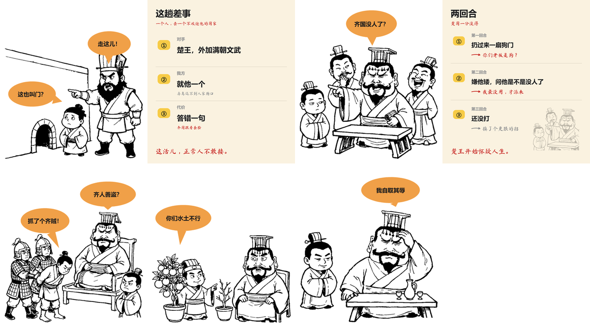

# 案例：《晏子使楚》74 秒 · 从选题到成片的完整记录

这是本 skill 的**验收基准**。所有阈值、配方、返工率预期都是从这一条片子跑出来的。
做新选题时先照着它对一遍；对不上，多半是某一步偷了懒。

<p align="center">
  
</p>

---

## 1. 成片数据

| 指标 | 实测值 |
|---|---|
| 时长 / 分辨率 | 74.3 秒 / 1080×1920（竖屏） |
| 文件 | 5.9 MB，H.264 + AAC |
| 结构 | 7 格＝5 个对话格 + 2 个信息图格 |
| 旁白 | 349 字，4.8 字/秒（`+14%` 语速，`zh-CN-YunjianNeural`） |
| 每格时长 | 对话格 9.6–13.0 秒，信息图格 8.9–10.1 秒 |
| 出图 | 5 张，返工 4 次（其中狗门那张出了 3 版） |
| 音量 | `mean_volume −20.0 dB` / `max_volume −1.5 dB` |
| 单步耗时 | 配音 15s / 叠层 5s / 排版 5s / 渲染 20s / 合成 30s |

**为什么拿它当基准**：它同时具备三种最难的形状——一个体型差（矮 vs 胖）、
一个多人挤压格（士兵+犯人+楚王+晏子）、一段需要「翻译成人话」的原话（橘子枳）。
这三样能过，选题基本没坑。

---

## 2. 七格分镜表

| 格 | 类型 | 画面承担什么 | 气泡 | 旁白在干什么 |
|---|---|---|---|---|
| s1 | 对话·浅蓝 | 门比人矮；门卫指着门喊，晏子仰头为难 | 「走这儿！」「这也叫门？」 | 报事实 + 吐槽（这不是门，这是狗洞） |
| s2 | 信息图·米黄 | 对手=整个楚国 / 我方=一个人 / 代价=齐国丢脸 | — | 把「有多难」量化 |
| s3 | 对话·浅蓝 | 楚王前倾指着矮个子，两侧文官一偷笑一大笑 | 「齐国没人了？」 | **翻译**那句原话（就派你这么个矮子） |
| s4 | 信息图·米黄 | 两回合记分牌：出了什么招 / 怎么被打回来 | — | 把战况收成一张表 |
| s5 | 对话·浅蓝 | 两个士兵押着反绑的人过堂，楚王坐着得意 | 「抓了个齐贼！」「齐人善盗？」 | 交代陷阱怎么摆的 |
| s6 | 对话·浅蓝 | 晏子一手扶橘树、一手指枯枝 | 「你们水土不行」 | 给结论，不回放台词 |
| s7 | 对话·浅蓝 | 楚王扶额摆手，晏子作揖 | 「我自取其辱」 | 收尾：地盘没变，但让人闭了嘴 |

两条硬约束在这条片子里各用了一次：

- **气泡说原话，念白说翻译**（可选手法，不是强制）。s3：气泡「齐国没人了？」（5 字），
  念白「翻译一下：就派你这么个矮子？」—— 关键是念白里有新信息（「矮子」），
  不是把气泡重说一遍。**念白如果只写「他问了一句」，就是废句。**
- **最后一格推翻前面某句正经话。** s7 把「出使成功」降格成「做买卖，值」。

---

## 3. story.json（可直接复制跑）

```json
{
  "title": "晏子使楚",
  "subtitle": "一个人，把一个大国说到闭嘴",
  "canvas": [1080, 1200],
  "gap": 0.15,
  "voice": "zh-CN-YunjianNeural",
  "rate": "+14%",
  "output": "final.mp4",
  "scenes": [
    {
      "id": "s1", "type": "art", "src": "g1.png", "bg": "sky",
      "narration": "晏子要去楚国出差。楚国给他开的门，一米四。这不是门，这是狗洞。人家摆明了：你先钻进来，咱们再谈。",
      "bubbles": [
        { "cx": 800, "cy": 320, "rx": 158, "ry": 90, "text": "走这儿！",
          "tail": [795, 470], "tail_w": 54, "at": 2.6 },
        { "cx": 235, "cy": 690, "rx": 175, "ry": 92, "text": "这也叫门？",
          "tail": [455, 745], "tail_w": 62, "at": 6.0 }
      ]
    },
    {
      "id": "s2", "type": "chart", "bg": "cream", "chart": "chart_s2", "pad": 1.0,
      "narration": "先看这活儿有多难。对面是整个楚国，他这边就一个人。答错一句，齐国跟着丢脸。",
      "bubbles": []
    },
    {
      "id": "s3", "type": "art", "src": "g3.png", "bg": "sky",
      "narration": "楚王一见他就乐：齐国没人了吗？翻译一下：就派你这么个矮子？晏子说：派谁去，得看对方什么货色。我最没用，所以派你这儿。",
      "bubbles": [
        { "cx": 560, "cy": 175, "rx": 185, "ry": 100, "text": "齐国没人了？",
          "tail": [566, 335], "tail_w": 60, "at": 4.5 }
      ]
    },
    {
      "id": "s4", "type": "chart", "bg": "cream", "chart": "chart_s4", "pad": 1.0,
      "narration": "两回合，楚国一分没得。第一回合想让他钻狗洞，被推回去了。第二回合嫌他矮，被反手排到了末位。",
      "bubbles": []
    },
    {
      "id": "s5", "type": "art", "src": "g5.png", "bg": "sky",
      "narration": "第三回合，楚王下狠手。绑了个人从他面前过，说这是齐国人，偷东西。楚王问：齐国人天生就会偷？",
      "bubbles": [
        { "cx": 330, "cy": 420, "rx": 178, "ry": 92, "text": "抓了个齐贼！",
          "tail": [432, 620], "tail_w": 58, "at": 4.0 },
        { "cx": 790, "cy": 225, "rx": 205, "ry": 92, "text": "齐人善盗？",
          "tail": [790, 340], "tail_w": 56, "at": 7.8 }
      ]
    },
    {
      "id": "s6", "type": "art", "src": "g6.png", "bg": "sky",
      "narration": "晏子说：橘子长在淮南是橘子，长在淮北就变枳。同一棵树，换个地方就变味。所以不是这人有问题，是这块地有问题。",
      "bubbles": [
        { "cx": 262, "cy": 400, "rx": 205, "ry": 95, "text": "你们水土不行",
          "tail": [238, 598], "tail_w": 60, "at": 7.5 }
      ]
    },
    {
      "id": "s7", "type": "art", "src": "g7.png", "bg": "sky",
      "narration": "楚王最后摆了摆手，说了句实话。三回合，楚国一次没赢。地盘没变，楚国还是那么大。但他让一个老板，当着满朝文武闭了嘴。这买卖，值。",
      "bubbles": [
        { "cx": 700, "cy": 195, "rx": 215, "ry": 95, "text": "我自取其辱",
          "tail": [738, 318], "tail_w": 58, "at": 4.5 }
      ]
    }
  ]
}
```

出图 prompt 不放这里（`story.json` 里那几段是文案草稿），成片用的是下面第 4 节里
**返修后的最终版**。想看脚本怎么读 `prompt` 字段，见 `scripts/comic_gen.py`。

---

## 4. 五张线稿的最终 prompt

通用部分由 `comic_gen.py` 的 `STYLE` 自动拼在最前面（白底线稿、马克笔、无灰阶、
无排线、文字禁令），下面只记**内容段**。

### s1 · 狗门（第 3 版才过）

> 画面左侧是一段高墙，墙脚下开着一扇非常矮小的拱门，门洞只到一个成年人胸口那么高，
> 矮得必须弯腰才能钻进去；拱门右边站着一个矮个子文士，头上**只扎一个深色的软布巾小髻，
> 绝对不要戴任何冠、不要戴方冠、不要戴高帽**，脸圆、**没有胡子**，穿宽袖长袍，双手拢在袖子里，
> 抬头盯着那扇矮门，一脸为难；画面右侧站着一个身材高大的门卫，头上**戴着高高的竖条纹硬方冠**，
> **满脸络腮浓须**，穿短打束腰，伸出一根食指指向那扇矮门，嘴巴张开在喊，表情不耐烦。
> 两个人都完整画在画面内，脚下踩在地面上，不要贴到画面左右边缘。人物都站在画面下半部。

> 两个人必须一眼能分清：**矮的那个头顶是软布巾、没有胡子、圆脸；高的那个头顶是高方冠、
> 满脸大胡子、方脸。帽子样式和胡须绝对不能一样。**

前两版失败点：门被画成正常尺寸（梗丢了）；第三版人物对了但晏子戴了门卫同款方冠，
读作「两个楚王」——这两个坑的处置见第 6 节。

### s3 · 开嘲

> 画面右侧一个戴楚国高冠、留浓密八字胡的胖大王坐在矮几后面，身体前倾，伸出一根食指
> 用力指向画面左侧，嘴巴大张、眼睛眯成一条线，一脸瞧不起；他左右各站一个楚国文官，
> 一个捂嘴偷笑、一个仰着脖子大笑；画面左侧站着一个矮个子文士，比旁边所有人矮一大截，
> 双手拢在袖子里，眼皮半垂，面无表情。

### s5 · 绑贼过堂

> 画面左侧两个穿短甲衣的楚国士兵，一前一后押着一个双手反绑在背后、低着头、赤着脚的人
> 从堂下走过，后面那个士兵伸手推着被绑人的后背；画面右侧坐着一个戴高冠的胖楚王，
> 双手抱着肚子靠在靠几上，下巴抬高，嘴角歪着得意地笑，眼睛饱饱地半闭；画面右下角站着
> 一个矮个子文士，双手拢在袖子里，侧过头盯着那个被绑的人，眉毛皱起。
> 所有人物都完整地画在画面内，不要贴到左右边缘，不要画举起手臂的动作。

### s6 · 橘与枳（第 2 版）

> 画面左侧站着一个非常矮小的文士，头顶只到成年人胸口的高度，他一只手扶着一盆结满
> 大圆果子的矮橘树，另一只手指向旁边一小盆干枯的细瘦树苗，抬着下巴，表情笃定；
> 画面右侧一个戴高冠的胖楚王坐在椅子上，身体向后一靠，嘴巴微张、眼睛睁圆，
> 一副被问住的表情；两盆植物并排放在两人中间的地面上，左边一盆又大又茂盛、
> 果子很圆很大，右边一盆又小又枯、只剩几根枝条。**两个人物的体型差非常明显**，
> 一个人高一个人矮。

第 1 版把晏子画成了正常身高，「矮」这个核心笑点当场消失，必须重出。

### s7 · 认输

> 画面右侧一个戴高冠的胖楚王坐在矮几后面，一只手撑在额头上，闭着眼睛，整个人向前
> 塔拉着，另一只手无力地向下摆了摆，一脸认输的表情；画面左侧一个矮个子文士，
> 双手抱在胸前向下作揖行礼，嘴角微微上扬，眼睛半闭着；两人中间摆着一张矮几，
> 几上放着一只酒壶和两只酒杯。

---

## 5. 两张信息图

信息图不进白板引擎，直接由 `charts.py` 的 `Comic` 画成整图再合成。诀窍是**每行只放一个信息**，
右边留 60px 防裁。

```python
from comic_layer import CREAM, GREY, INK, RED, YELLOW, Comic

def chart_s2(c: Comic):
    """这趟差事有多难：对手一整国，我方一个人。"""
    c.note((60, 96), "这趟差事", color=INK, size=64, anchor="lm", kind="hei")
    c.note((60, 172), "一个人，去一个不欢迎他的国家", color=RED, size=32, anchor="lm")
    rows = [
        ("①", "对手", "楚王，外加满朝文武", None),
        ("②", "我方", "就他一个", "身高还不到人家胸口"),
        ("③", "代价", "答错一句", "齐国跟着丢脸"),
    ]
    for i, (no, label, main, sub) in enumerate(rows):
        y = 330 + i * 250
        c.tag(120, y, no, fill=YELLOW, size=40, padx=26, pady=16)
        c.note((215, y - 44), label, color=GREY, size=30, anchor="lm", kind="hei")
        c.note((215, y + 34), main, color=INK, size=52, anchor="lm", kind="hei")
        if sub:
            c.note((215, y + 106), sub, color=RED if i == 2 else GREY, size=30, anchor="lm")
        if i < 2:
            c.hline(y + 160, 60, 1080 - 60)
    c.note((60, 1110), "这活儿，正常人不敢接。", color=RED, size=50, anchor="lm")
```

`chart_s4` 换成「回合 / 出招 / 回击」三行 + `c.arrow()` 画回击箭头即可。

**两张信息图的右下角都有底衬**——三行字只占左边 2/3，右半边一定空，
铺一张淡掉的「上一格」就不空了。这件事是**自动的**，`charts.py` 里一行都没写：

```
python scripts/comic_layers.py . --only charts
     底衬 ← boards/s1.png      → charts/s2.png
     底衬 ← boards/s3.png      → charts/s4.png
```

| 格 | 底衬 | 语义 |
|---|---|---|
| s2「这趟差事」 | s1（狗门：门卫、矮门、晏子） | 刚被拦在门外 |
| s4「两回合」 | s3（楚王前倾指人） | 上一回合正在打 |

规则在 `comic_layers._paint_backdrop()`：本格之前最近的线稿格优先，
前面没有就按格的 id 固定随机一张；按墨迹包围盒裁掉气泡留白，装进
右下角 `655,715,365,425`，`opacity=0.28`。

两个要注意的：

- **不要自己 `c.art()`**。自动贴发生在 `fn(c)` 之前（这样字才压在最上层），
  你再贴一张就叠两层。某格不想要就写 `"backdrop": false`。
- **别用 zoompan 让它动**。字会一直抖，见 `comic-story.md` 铁律 2。

信息图两格都要写 `"pad": 1.0`——静帧不加 1 秒以上的延时会像卡住。
`comic_finish.py` 现在只做 0.35 秒淡入。

---

## 6. 实际跑的命令

```bash
# 项目目录
mkdir yianzi-story && cd yianzi-story
cp <skill>/templates/comic/story.example.json story.json
cp <skill>/templates/comic/charts_example.py charts.py

# ① 出图 prompt（贴给 ImageGen，参考图 = assets/reference/01-style-anchor.png，fidelity=low）
python <skill>/scripts/comic_gen.py . --list

# ② 图放进 raw/ 后：净化排版（不切图，节奏靠 draw_duration）
python <skill>/scripts/comic_boards.py .

# ③ 逐格配音（同时体检字数/语速）
python <skill>/scripts/comic_tts.py .

# ④ 气泡层 + 信息图
python <skill>/scripts/comic_layers.py . --only bubbles
python <skill>/scripts/comic_layers.py . --only charts     # 先单独看两张信息图排版

# ⑤ 出一条
python <skill>/scripts/comic_run.py . --quality high
```

改文案后**不要只跑最后一步**：`comic_tts.py` 会按文案指纹重配，
`render_explainer.py` 会按图+音频指纹重渲，直接重跑 `comic_run.py` 就会全对。

---

## 7. 这次踩的四个坑

| 坑 | 症状 | 真因 | 处置 |
|---|---|---|---|
| 狗门不像狗门 | 门画成正常尺寸 | prompt 只写「又矮又窄」，模型没有参照系 | 写「门洞只到一个成年人胸口」，并把高度对比再说一遍 |
| 两个楚王 | 晏子戴着门卫同款方冠 + 同款大胡子 | 「矮一点的同款冠」不是区分，模型照抄冠型 | 主角换**异类**头饰（软布巾小髻/无冠）+ 去胡须；见 `prompt-recipes.md` §2.0 |
| 气泡像手指发的 | 「这也叫门？」尾巴尖落在门卫指人的手指上 | 气泡位置只按「空白最多」摆，没核对尾巴落点 | 气泡挪到左侧空白，尾巴指晏子头顶：`tail: [455, 745]` |
| 换了图画面没变 | 重出 s1 后成片还是旧画面，零报错 | 分拍缓存只比时长，时长没变就沿用旧 mp4 | 已修：`.stamp` 记「图内容+音频+画质」指纹（`render_explainer.py`） |

另外两个是流程性的：

- ~~气泡和旁白说了同一件事~~ —— **这条判据已废，别再用。** 初版 4 格是气泡
  「你们水土不行」、字幕「是你们这儿水土不行」，当时按「不能重复」改了。
  真正该改的不是重复，是**重复且没有新信息**：念白只是把气泡换个说法，等于白配；
  念白在推进（给根据、给后果、给吐槽），重复反而是重点强调。
  **别因为重复就把台词从念白里删掉** —— 删到最后只剩「他问了一句」。见 SKILL.md「念白」。
- **改完文案不重配音。** 早期 `comic_tts.py` 只看 mp3 在不在，声音是旧的、字幕是新的。已修。

---

## 8. 抽帧验收记录

```bash
python scripts/verify_media.py --file out/final.mp4 --expect 74.3
ffmpeg -y -ss 3  -i out/final.mp4 -vframes 1 check/03.png
ffmpeg -y -ss 48 -i out/final.mp4 -vframes 1 check/48.png
ffmpeg -i out/final.mp4 -af volumedetect -f null -
```

肉眼过了这四条才算完：

1. 绘制铺开 —— `ink_probe.py` 量：s1 的 95% 在 5.5s（预算 7.9s，70%），5 格全部命中
2. 2.6 秒前没有气泡，之后逐个弹出 —— 气泡时机跟着旁白
3. 底色是浅蓝 `#CBE3F5` / 米黄 `#FAF2E0`，不是绿、不是白
4. 底部大字幕不裁边、不压画面里的气泡

---

## 9. 换个选题，照抄这张清单

> 下面这份清单是《晏子使楚》当时的执行记录（旧配音方案：edge + `+14%` = 4.7 字/秒，
> 7 格 60–70 秒）。**新片按 SKILL.md 的标准来：8 格、110–130 秒、4.0 字/秒。**
> 清单里真正可复用的是结构和出图约束，不是这些字数。

- [ ] 7 格：5 对话 + 2 信息图，第 1 格直接进冲突，不要开场白
- [ ] 旁白 300–360 字，`+14%` 语速，一格 60–70 字
- [ ] 每格一个气泡、≤8 字；气泡给原话，念白必须让人听懂说了什么（不能是「他说了一句」）
- [ ] 主角开口碑之外还有毛病（晏子的毛病是矮），不然没法「自曝」
- [ ] 给每个角色开身份证：头饰/胡须/衣服/体型，任意两人至少三项不同
- [ ] 体型差写参照，不写「矮个子」
- [ ] 两张信息图各写 `"pad": 1.0`
- [ ] 最后一句推翻前面某句正经话
